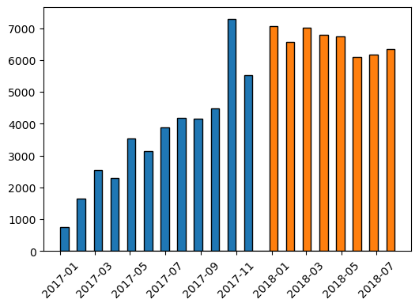
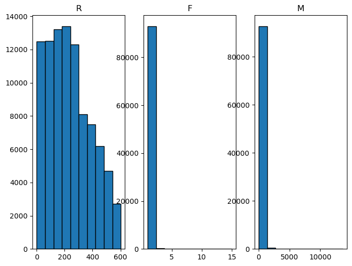
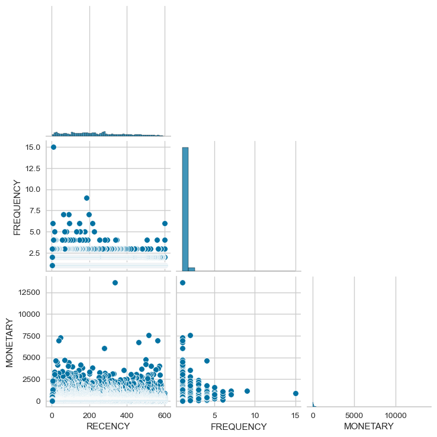
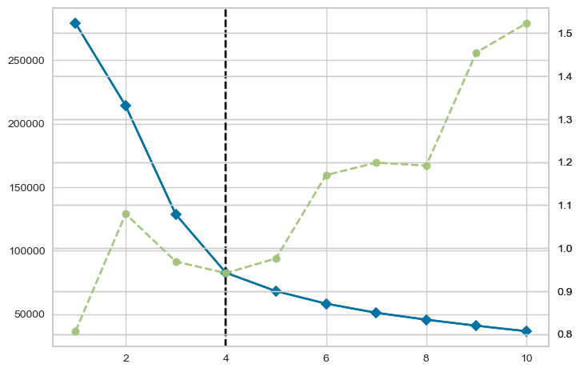
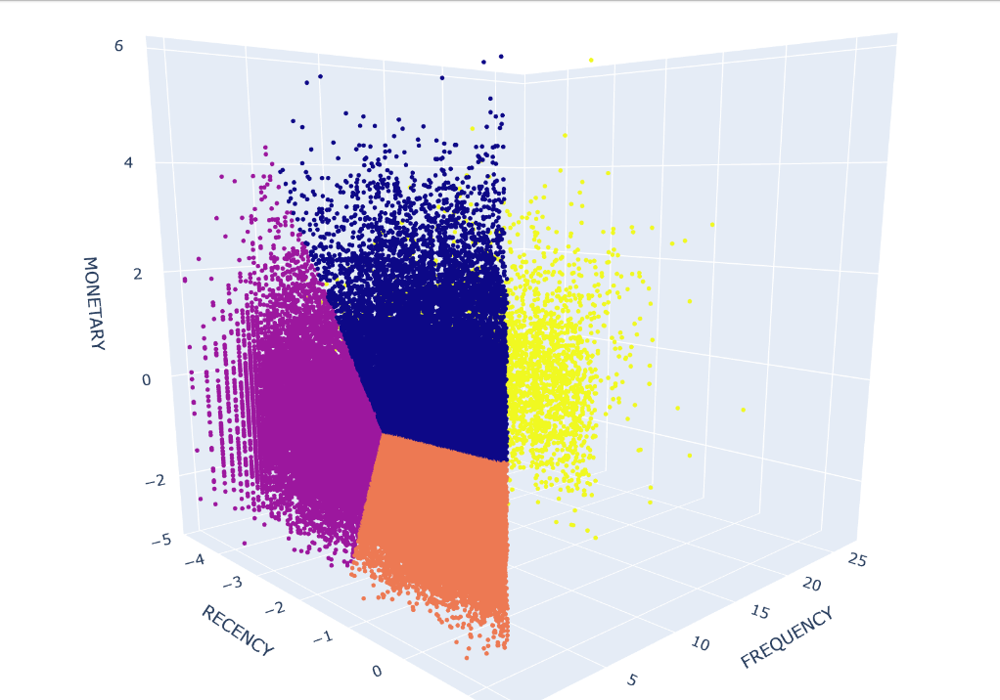
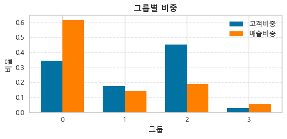
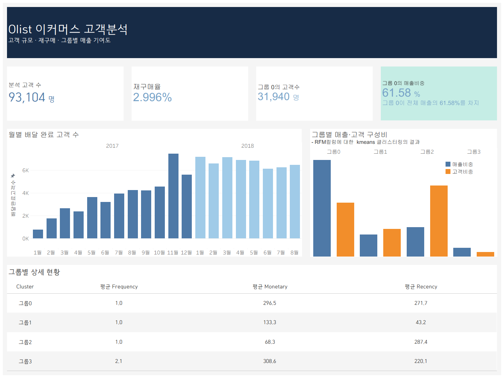

# Olist 이커머스 데이터 분석
### 재구매율을 높이려면 어느 고객군부터 공략해야 할까?

Oracle DB에 적재한 Olist 이커머스 데이터를 **SQL로 RFM 변수로 만들고**, **K-means 군집화**로 고객을 4개 그룹으로 나눈 뒤 **매출 기여도가 가장 큰 그룹**을 찾은 개인 프로젝트입니다. 분석 결과는 Tableau 대시보드로 시각화했습니다.

| 항목 | 내용 |
|---|---|
| 기간 | 2026.02 수행 · 2026.10 고도화 |
| 인원 | 1명 (개인 프로젝트) |
| 사용 도구 | Oracle DB, SQL, Python (pandas, numpy, scikit-learn, yellowbrick, matplotlib, seaborn, plotly), Tableau |

---

## 1. 배경 및 문제



- 2017년에는 월 주문 건수가 계속 증가했지만, **2018년에 들어서는 더 이상 증가하지 않았습니다.**
- 재구매율도 **2.996%** 로 낮았습니다.

> **문제: 재구매율을 높이기 위해, 어느 고객군에게 먼저 효율적으로 광고해야 할까?**

## 2. 데이터

- 브라질 Olist사의 이커머스 데이터셋 (총 9개 테이블)
- 분석에 사용한 테이블: `olist_orders_dataset`, `olist_customers_dataset`, `olist_order_payments_dataset`

데이터 구조 확인 (`1_order_items_check.sql`)
- `olist_order_items_dataset` 전체 112,650행. 같은 상품을 여러 개 사면 `order_item_id`만 늘어남
- `olist_orders_dataset` 99,441행, `order_id`·`customer_id` 모두 중복 없음
- `customer_id`와 `customer_unique_id`가 다름 → **개별 고객은 `customer_unique_id`로 판별**

## 3. 전처리 (분석 대상 선정)

| 기준 | 내용 |
|---|---|
| ① 기간 | **2017년 1월 ~ 2018년 8월 (20개월)**. 월별로 나열했을 때 이전·이후 기간은 주문 건수가 매우 적어 분석에서 제외 |
| ② 주문 상태 | 배송 완료(`delivered`) 주문만 사용. 취소, 배송 중 등은 제외 |
| ③ 고객 기준 | `customer_unique_id`로 같은 고객의 주문을 묶음 |

- 배송 완료 주문: **96,211건**
- 분석 대상 고객: **93,104명**
- 주문 수와 고객 수가 다른 이유: 한 고객이 여러 번 주문할 수 있기 때문

```sql
WHERE O.order_status = 'delivered'
  AND O.order_purchase_timestamp >= TO_DATE('2017-01-01','YYYY-MM-DD')
  AND O.order_purchase_timestamp <  TO_DATE('2018-09-01','YYYY-MM-DD')
```

## 4. 변수 생성: R · F · M

| 변수 | 정의 |
|---|---|
| **R** (Recency) | 기준일(2018-08-30) − 마지막 구매일. 데이터의 마지막 구매일이 2018-08-29라 다음 날을 기준일로 설정 |
| **F** (Frequency) | 배송 완료 주문 수 |
| **M** (Monetary) | 결제 금액 합계 |

M 계산 과정
1. 처음에는 `order_items`의 `price`를 합산 → 일부 금액이 비정상적으로 작게 나오는 오류 발견
2. `order_payments`의 `payment_value`로 변경
3. 한 주문에 결제가 여러 건이면 조인 시 중복 집계 → **주문별 결제 합계를 WITH 절로 먼저 만든 뒤 조인**

```sql
WITH Payment_view AS (
  SELECT order_id, SUM(payment_value) Monetary
  FROM olist_order_payments_dataset
  GROUP BY order_id
)
SELECT customer_unique_id,
       TRUNC(TO_DATE('2018-08-30','YYYY-MM-DD')) - TRUNC(MAX(order_purchase_timestamp)) AS Recency,
       COUNT(C.customer_unique_id) AS Frequency,
       SUM(P.Monetary) AS Monetary
FROM olist_orders_dataset O, olist_customers_dataset C, Payment_view P
WHERE O.order_id = P.order_id
  AND O.customer_id = C.customer_id
  AND O.order_status = 'delivered'
  AND O.order_purchase_timestamp >= TO_DATE('2017-01-01','YYYY-MM-DD')
  AND O.order_purchase_timestamp <  TO_DATE('2018-09-01','YYYY-MM-DD')
GROUP BY customer_unique_id
ORDER BY Recency DESC, Frequency DESC, Monetary DESC;
```

→ 결과: **93,104행** (고객 1명당 1행). Python에서 `oracledb`로 Oracle에 직접 연결해 불러왔습니다.

## 5. 모델 선택: K-means

- **어떤 모델?** 클러스터링. 군집 정답이 없는 데이터라 비지도학습을 사용
- **K-means란?** 데이터 간 거리를 기반으로, 정한 k개의 군집으로 데이터를 나누는 모델
- **왜 K-means인가?**
  1. R · F · M 데이터의 분포에 특별한 밀도 차이가 나타나지 않아, 밀도 중심의 DBSCAN 대신 K-means 선택
  2. 계산량이 적어 군집화 속도가 빠름

| | K-means | DBSCAN |
|---|---|---|
| 군집 기준 | 거리 (군집 중심) | 밀도 |
| 군집 수 | k를 직접 지정 | 자동 결정 |
| 계산량 | 적음 (빠름) | 상대적으로 많음 |

## 6. 모델에 맞춘 전처리



- RFM 분포를 보니 데이터가 매우 치우쳐 있음. 특히 F와 M은 대부분 낮은 값에 몰려 있고 일부 극단값이 큼
- K-means 같은 거리 기반 모델은 극단값에 영향을 많이 받으므로 스케일링이 필수
- 처리 방법
  1. `np.log1p`로 로그 변환 → 극단값 완화
  2. `StandardScaler`로 표준화 → 변수 간 단위(일 · 횟수 · 금액) 차이 제거

<details>
<summary>RFM pairplot</summary>


</details>

## 7. 최적 군집 수 선정 (엘보우 기법)



- x축: 군집 수 k (1~10)
- 왼쪽 y축(파란 선): distortion score, 각 고객과 소속 군집 중심 간 거리 제곱합(inertia)
- 오른쪽 y축(초록 점선): 모델 학습 시간(초)
- 감소 폭이 줄어드는 지점에서 **k = 4** (inertia 82,597)
- 설정: `init='k-means++'`, `n_init=10`, `random_state=42`

## 8. 군집 결과와 그룹 명명



| 그룹 | 고객 수 | R 평균(일) | F 평균(회) | M 평균 | 이름 | 특징 |
|---|---:|---:|---:|---:|---|---|
| 그룹0 | 31,940 | 271.7 | 1.00 | 296.5 | **휴면 고액 고객** | 오래 구매하지 않았지만 구매 금액이 큼 |
| 그룹1 | 16,299 | 43.2 | 1.00 | 133.3 | 신규 고객 | 가장 최근에 구매함 |
| 그룹2 | 42,076 | 287.4 | 1.00 | 68.3 | 휴면 저액 고객 | 오래 구매하지 않았고 구매 금액도 작음 |
| 그룹3 | 2,789 | 220.1 | 2.11 | 308.6 | 충성 고객 | 2번 이상 구매, 구매 금액이 가장 큼 |

## 9. 그룹별 비중과 결론



| 그룹 | 고객 비중 | 매출 비중 | 결제 금액 합계 |
|---|---:|---:|---:|
| 그룹0 휴면 고액 고객 | 34.31% | **61.58%** | 9,468,959.07 |
| 그룹1 신규 고객 | 17.51% | 14.13% | 2,172,774.87 |
| 그룹2 휴면 저액 고객 | 45.19% | 18.69% | 2,873,386.94 |
| 그룹3 충성 고객 | 3.00% | 5.60% | 860,754.56 |

### 결론
- **휴면 고액 고객**은 고객 비중이 두 번째(34.31%)지만 **매출 비중은 61.58%로 가장 높습니다.**
- 효율적인 재구매로 매출을 늘리려면 **휴면 고액 고객부터 공략**하는 것이 효과적입니다.

### 향후 과제
- 아이템 기반 임베딩 후 딥러닝 모델로 고객별 상위 Top 5 상품 추천

## 10. 대시보드 시각화 (Tableau)



Tableau를 Oracle에 연결해, 데이터가 바뀌면 수치가 실시간으로 반영되는 대시보드를 만들었습니다. (Tableau 파일: `olist대시보드.twbx`)
- KPI: 분석 고객 수 93,104명, 재구매율 2.996%, 그룹0 고객 수 31,940명, 그룹0 매출 비중 61.58%
- 월별 배달 완료 고객 수 (2017 / 2018)
- 그룹별 매출 · 고객 구성비
- 그룹별 상세 현황 (평균 Frequency · Monetary · Recency)

---

## 파일 구성

```
olist_ecommerce_analysis
├── 1_order_items_check.sql   # 데이터 구조 확인, 전처리 기준 설정, RFM 쿼리 작성 과정
├── making_image.ipynb        # 월별 주문 추이, RFM 분포 시각화
├── connect2oracle.ipynb      # Oracle 연결 → RFM 로드 → 로그 변환·표준화 → K-means → 그룹별 비중
├── rfm_final_result.csv      # 고객별 R · F · M과 군집 결과 (connect2oracle.ipynb 출력)
├── olist대시보드.twbx         # Tableau 대시보드 파일
├── olist대시보드.png          # Tableau 대시보드 이미지
├── images/                   # README 이미지
│   ├── 01_monthly_orders.png
│   ├── 02_rfm_hist.png
│   ├── 03_rfm_pairplot.png
│   ├── 04_elbow.png
│   ├── 05_cluster_3d.png
│   ├── 06_group_ratio.png
│   └── 07_tableau_dashboard.png
├── .gitignore
└── README.md
```

## 실행 방법

1. 패키지 설치
   ```bash
   pip install oracledb pandas numpy python-dotenv matplotlib seaborn scikit-learn yellowbrick plotly
   ```
2. 프로젝트 폴더에 `.env` 파일을 만들고 Oracle 접속 정보를 입력합니다. (`.env`는 `.gitignore`에 추가해 공개되지 않게 관리)
   ```
   DB_USER=사용자명
   DB_PASSWORD=비밀번호
   DB_HOST=호스트
   DB_PORT=포트
   DB_SERVICE_NAME=서비스명
   ```
3. `making_image.ipynb`, `connect2oracle.ipynb` 순서로 실행합니다.
